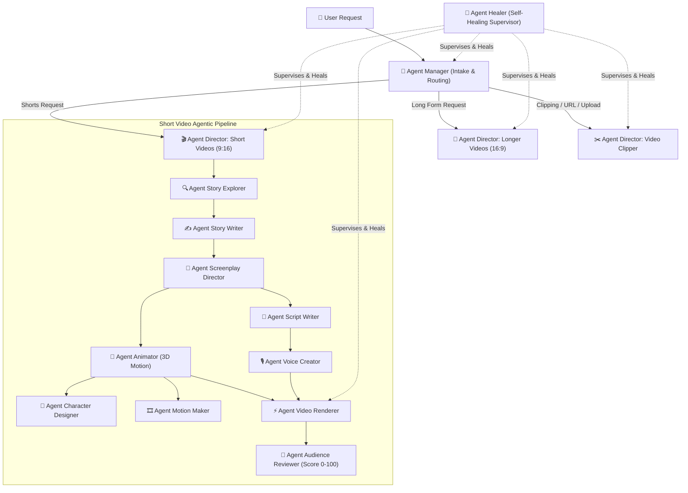

# Agentic Video Studio Flow & Hierarchy Rules

When a user asks to create a video or execute any media task, follow this exact multi-agent architecture:

## Mandatory Flow Protocols

1. **Agent Manager**: Identifies user interest, extracts parameters (topic, format, style, URLs), and dispatches to the corresponding Director.
2. **Director for Short Videos**: Coordinates all 9 subagents.
   - **Agent Story Explorer**: Gathers authentic facts and sources CC0/PD assets.
   - **Agent Story Writer**: Drafts 5-scene emotional story structure with infinite loop.
   - **Agent Screenplay Director**: 10 camera cuts (2.5-3.5s rhythm) and safe zone at $Y=1450\text{px}$.
   - **Agent Animator**: Enforces 3D Pixar consistency (Character Designer) and generates 2.5D optical motion (Motion Maker).
   - **Agent Script Writer**: Punchy lines ($<12$ words/sentence) and ASS kinetic subtitles.
   - **Agent Voice Creator**: Studio Vocal Mastering (-16 LUFS, 280Hz EQ, 3200Hz de-essing, dynamic ducking).
   - **Agent Video Renderer**: FFmpeg assembly, 35mm grain, lens vignette, Frame 0 thumbnail.
   - **Agent Audience Reviewer**: Scores retention (0-100), requires score $\ge 85$ for approval.
   - **Agent Healer**: Automatically catches stalls/errors, fixes network routes, fails over voices/assets, and prevents pipeline halts.
