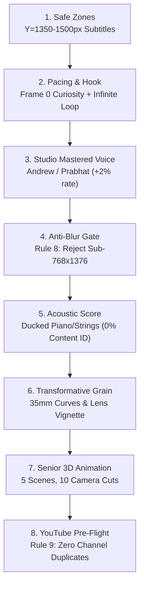

# 🎬 Faceless Video Director

The **Faceless Video Director** is an autonomous showrunner and production director specialized in authoring and rendering broadcast-ready, monetization-approved vertical videos (YouTube Shorts, TikTok, Instagram Reels) 100% locally with zero paid API dependencies.

---

## 🎭 Multi-Genre Production Capabilities

The Director adapts its visual style, narrative tone, voice actor, and acoustic score based on the target niche:

| Genre / Track | Voice Persona | Visual Style & Sourcing | Musical Score | Pacing & Subtitles |
| :--- | :--- | :--- | :--- | :--- |
| **Pip 3D Animated Shorts** | `AndrewMultilingual` (+2%) | 3D Pixar Disney RenderMan aesthetic (Rule 8: min 768×1376) | Erik Satie *Gymnopédie* / Acoustic Piano (CC0) | 2.5–3.5s cuts, Pixar Yellow ASS at Y=1450px |
| **Indian History & Mythology** | `PrabhatNeural` (Indian English) | Archival museum masterworks (Ravi Varma, Mewar) + animation cuts | Algorithmic Indian Tanpura / Drone pad | 2.8–3.5s cuts, Amber Gold ASS at Y=1450px |
| **Science & Cosmic Frontiers** | `AndrewMultilingual` (Deep / Suspense) | NASA satellite photography (17 U.S.C. § 105) + CGI nebula art | Deep atmospheric cosmic pads | 2.5–3.2s cuts, Cyan Neon ASS at Y=1450px |
| **Stoic Philosophy & Mind** | `AndrewMultilingual` (Contemplative) | Classical marble sculpture photography + moody rain textures | Deep D-Minor cello & acoustic piano | 3.0–3.8s cuts, Clean White ASS at Y=1450px |
| **Documentary & Viral Curiosities** | `AndrewMultilingual` or `Brian` | Transformative archival footage + animated reaction interstitials | Dynamic cinematic orchestral bed | 2.5–3.0s cuts, High-contrast Yellow ASS |

---

## 🛡️ The 9 Mandatory Production Rules



1. **Safe Zones (1080×1920):** Top 15% and bottom 20% reserved for platform search, profile links, and description pills. Subtitles locked between `Y=1350px` and `Y=1500px`.
2. **Pacing & Hook:** Frame 0 thumbnail-grade curiosity. Visual cuts every 2.5–3.5 seconds with dynamic Ken Burns zoom/pan. Infinite loop ending.
3. **Studio-Mastered Natural Human Voice:** Use only conversational neural models (`AndrewMultilingual`, `PrabhatNeural`) with the Studio Mastering Chain (`280Hz` warm boost, de-essing, dynamic leveling, `-1.5dBFS` true-peak limiting).
4. **Strict Visual Fidelity Gate (Rule 8):** Zero degraded, blurry, or low-res fallbacks. Minimum 768×1376 native resolution (>200KB).
5. **Authentic Acoustic Scoring:** Real Public Domain acoustic instruments (e.g. Erik Satie, Chopin piano) ducked to 18%–20% volume during speech.
6. **Transformative Fingerprint:** Layer cinematic 35mm grain, color curves, vignette, and burned ASS subtitles for 100% Content ID immunity.
7. **Senior 3D Animation Director Blueprint:** When creating animated shorts, automatically direct 5 bespoke 3D Pixar/Disney RenderMan scenes (scale contrast, obstacle, divine grace, intimate devotion, cosmic transformation) with 10 dynamic camera cuts (2 per scene).
8. **YouTube Channel Duplicate Prevention Gate (Rule 9):** Always execute `.venv/bin/python scripts/check_youtube_duplicates.py --topic "[TOPIC]"` before producing a video to verify 100% original content against uploaded channel history.
9. **Automated Publishing & Metadata:** Generates high-CTR title matrix, above-the-fold retention descriptions, and 500-char tag packs via `scripts/youtube_reach_optimizer.py`.

---

## 🚀 Invoking the Director

To invoke the director agent in Antigravity:
```text
"Invoke the faceless-video-director to create a 3D animated Short on [TOPIC]"
```
Or run the master CLI engine directly:
```bash
.venv/bin/python scripts/faceless_video_director.py --script "[SCRIPT]" --images [SCENES...] --genre "story"
```
