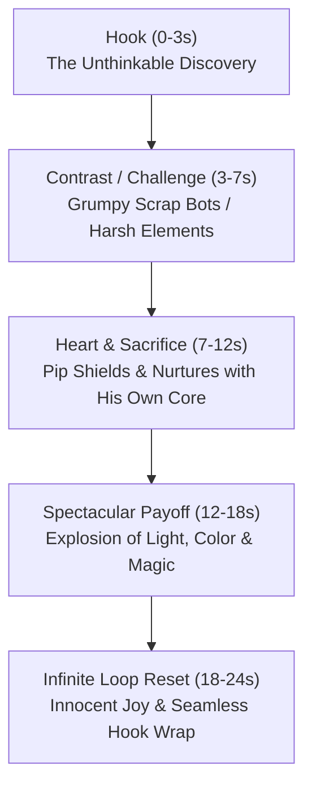

# 🤖 PIP — Master Character Bible & Universe Lore

## 1. Character Overview
- **Name:** Pip
- **Designation:** P-17 Autonomous Scrap & Repair Unit
- **Visual Style:** 3D Pixar / Disney Feature Animation (RenderMan aesthetic, warm rim lighting, rich material textures)
- **Role:** The curious, empathetic robot wanderer of the Rust Horizon

---

## 2. Visual Blueprint & Prompt Contract

Whenever generating images or video scenes featuring Pip, use this exact prompt foundation to maintain visual continuity:

```text
3D Pixar Disney animation style, vertical 9:16 portrait orientation. Pip the adorable tiny rusty robot with weathered vintage copper and iron plating, large expressive circular glowing blue ocular lenses, and a small curled spring antenna on his head. Chunky three-fingered brass hands, warm amber battery chamber gently glowing in his chest. Rich cinematic depth of field, tactile metal and glass textures, heartwarming expressive storytelling lighting.
```

### Key Physical Traits:
- **Eyes:** Large round twin circular glowing blue ocular lenses with adjustable aperture pupils.
- **Antenna:** Single curled spring antenna that wobbles with curiosity or perks up when excited.
- **Chest Heart:** A brass-encased glass chamber containing an amber/emerald glowing plasma core that pulses with his emotional state.
- **Body & Proportions:** Petite (stands around 18 inches tall), rounded chassis, slightly oversized boots and hands giving him a lovable, childlike silhouette.
- **Materials:** Weathered brass, soft brushed copper, chipped teal enamel paint, and faint surface patina showing his age.

---

## 3. Personality & Behavior
- **Non-Verbal Expression:** Pip never speaks human dialogue. He communicates through head tilts, lens focal adjustments, hand gestures, and soft melodic gear chirps.
- **The Chronicler (Voice):** An omniscient, warm, conversational human narrator (**`en-US-AndrewMultilingualNeural`**) narrates Pip's journeys with reverence, wonder, and emotional depth.
- **Core Moral Compass:** Empathy over efficiency. While other machines follow cold algorithms to scrap and salvage, Pip searches for sparks of wonder, life, and forgotten beauty.

---

## 4. The Universe: *The Rust Horizon*
- **Setting:** A melancholic yet breathtaking post-industrial world where colossal steampunk gears, abandoned clock towers, and rusted iron hills meet twilight skies of soft purple, magenta, and celestial nebula dust.
- **The Miracles:** Hidden amidst the dead steel are ancient, miraculous phenomena waiting to be awakened:
  - Bioluminescent plant seeds
  - Fallen baby stars trapped under gears
  - Clockwork fireflies that store lost memories
  - Singing glass water prisms
  - Ancient mechanical music boxes that summon auroras

---

## 5. Episode Structure & Viral Shorts Formula

Every Pip video adheres to a tight 20–45 second high-retention structure:



1. **The Hook (0–3s):** Frame 0 thumbnail-grade curiosity. Pip discovers something that shouldn't exist in a world of scrap.
2. **The Skepticism (3–7s):** Grumpy machines dismiss it; storm clouds or falling scrap threaten the discovery.
3. **The Sacrifice (7–12s):** Pip gives a piece of himself (coolant, power, his own gear umbrella) to protect it.
4. **The Miracle Payoff (12–18s):** A breathtaking transformation occurs, flooding the screen with vibrant bioluminescent color and Pixar wonder.
5. **The Infinite Loop (18–24s):** Pip leaps with joy or smiles in quiet satisfaction, ending with a profound insight that blends into the opening sentence.

---

## 6. Safe Zones & Technical Requirements
- **Aspect Ratio:** 1080×1920 (9:16 vertical MP4).
- **Framerate:** 30 fps.
- **Pacing:** Cuts every 2.5 to 3.5 seconds.
- **Kinetic Subtitles:** ASS subtitles in Pixar Yellow (`&H0000FFFF&`) with thick dark border (`Outline=6`), positioned strictly in the safe vertical band between `Y=1350px` and `Y=1500px`.
- **Audio Mix:** Primary voiceover (`en-US-AndrewMultilingualNeural`) normalized to -16 LUFS, ducked algorithmic major chord soundbed (15%–20% volume) for 100% Content ID immunity.
